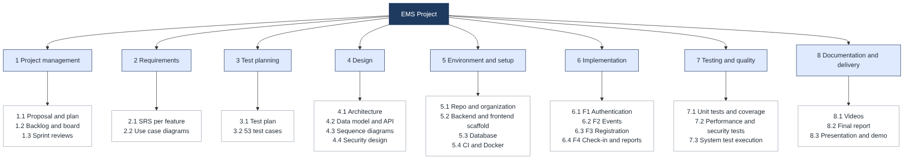
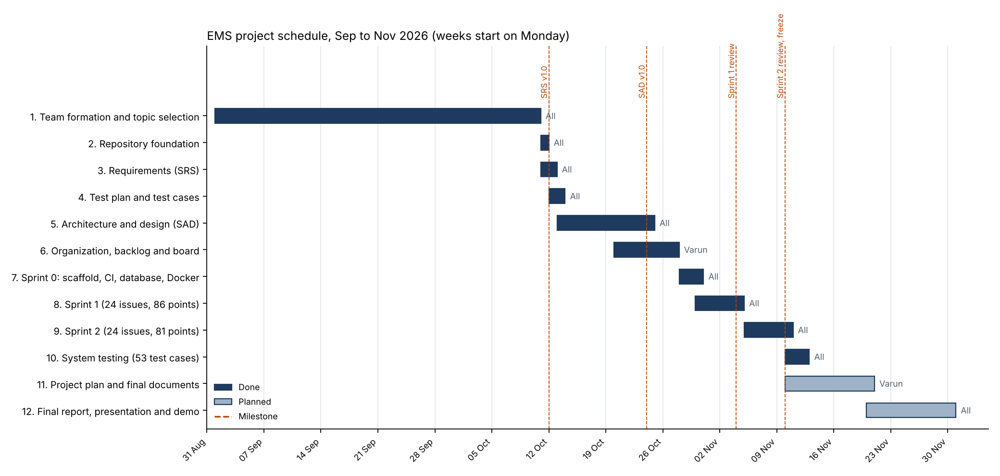

# Project Plan: Event Management System (EMS)

**Course:** UE24CS341A Software Engineering, PES University, Aug to Dec 2026
**Team:** Group 7 (to confirm)

| Member | SRN | Feature owned |
|--------|-----|---------------|
| Varun Rao | PES1UG24CS520 | F1 Authentication and role management |
| Thanishq Raam Patil | PES1UG24CS502 | F2 Event creation and management |
| Vishruta | PES1UG24CS538 | F3 Event registration and ticketing |
| Nithin Kumar M | PES1UG25CS829 | F4 Check-in, notifications and reports |

**Repository:** https://github.com/SE-MINIPROJECT-ORG/SWE-MiniProject

## 1. Lifecycle model

**Model: Agile, using Scrum with two implementation sprints**, preceded by an up-front phase for requirements and design ("Sprint 0").

| Scrum element | How it was used in this project |
|---------------|----------------------------------|
| Product backlog | 48 GitHub Issues: 30 functional, 6 non-functional, 7 security requirements and 5 setup items, each with story points (`sp-N` label), an owner and a priority |
| Sprints | Sprint 1 (30 Oct to 4 Nov, 24 issues, 86 points) and Sprint 2 (5 to 10 Nov, 24 issues, 81 points), as GitHub milestones |
| Sprint board | GitHub Project "EMS Product Backlog" with To do, In progress and Done columns; cards move to Done when the pull request closes the issue |
| Sprint goal and review | Each sprint ends with a working, demonstrated product, a recorded video (1 minute and 2 minutes) and a written review listing completed issues and deviations (`docs/sprint-reviews`) |
| Definition of done | Code merged through a pull request that closes its issue, reviewed and approved by another member, green CI (lint, unit tests, build), and documented |
| Roles | Each member is the product owner of their feature. Varun coordinated the team (Scrum Master role); Vishruta, as repository owner, merged pull requests |

### Why Agile/Scrum

1. **Required by the course:** the guidelines allow only an Agile methodology, and ask for a backlog, sprints, CI/CD and code reviews.
2. **Feature ownership fits Scrum:** each member owns one feature end to end, so the backlog splits cleanly into per-member stories that can be estimated and tracked on one board.
3. **Working software at the end of each sprint:** the course asks for a working-product video after Sprint 1 and after Sprint 2. Short sprints make that natural.
4. **Feedback and change:** the teacher reviews the work between sprints, and deviations from the documents are expected to be recorded and explained. Scrum's sprint review is the place to do that.
5. **Short timeline and fixed team:** about ten weeks with four part-time students. A plan-driven model (Waterfall) would leave all testing to the end; Scrum spreads integration and testing across the sprints.

The requirements (SRS), test plan and architecture (SAD) were still written before coding, because the course grades them as separate deliverables in IEEE format. In Scrum terms this is the inception work of Sprint 0; the documents were then used as the backlog and the acceptance criteria.

## 2. Tools

| Purpose | Tool |
|---------|------|
| Version control and code review | Git, GitHub (organization `SE-MINIPROJECT-ORG`, pull requests, branch protection on `main`) |
| Backlog, sprints and board | GitHub Issues, Milestones and Projects |
| CI/CD | GitHub Actions: lint, unit tests with coverage gate, frontend build on every pull request and on `main` |
| Frontend | React 18 with Vite, React Router |
| Backend | Node.js 20, Express 4 |
| Database | PostgreSQL 16 |
| Unit testing | Jest and Supertest (backend), Vitest (frontend) |
| Static analysis | SonarQube (local Docker) and ESLint |
| Packaging and running | Docker and Docker Compose; nginx as HTTPS reverse proxy |
| Email testing | MailHog (mock SMTP server) |
| Performance and concurrency testing | Team scripts in `backend/scripts` (load test, concurrency test, uptime monitor) |
| Diagrams | PlantUML, Graphviz, Mermaid |
| Team communication | GitHub pull request reviews and the team chat |

## 3. Deliverables: reuse and build

| Deliverable | Reuse or build | Notes |
|-------------|----------------|-------|
| Web framework, routing, UI library | Reuse | React, React Router, Express |
| Database engine | Reuse | PostgreSQL |
| Password hashing, tokens, email, scheduling, QR codes, security headers, rate limiting | Reuse | bcryptjs, jsonwebtoken, Nodemailer, node-cron, qrcode, helmet, express-rate-limit |
| Web server and TLS | Reuse | nginx with a self-signed certificate for local use |
| CI, static analysis, containers | Reuse | GitHub Actions, SonarQube, Docker images |
| Database schema, migrations and seed data | Build | 7 tables (`backend/db`) |
| Backend modules: auth, events, registrations, check-in, notifications, reports | Build | REST API with 32 endpoints |
| Frontend pages | Build | 21 pages and components for visitors, attendees, organizers and admins |
| Unit tests | Build | 205 backend and 36 frontend tests |
| Load, concurrency and uptime test scripts | Build | `backend/scripts` |
| SRS, test plan, SAD, project plan, sprint reviews, test reports, final report | Build | `docs/` |
| Demo videos | Build | `docs/videos` |

## 4. Work breakdown structure

| WBS | Work package | Main outputs | Owner |
|-----|--------------|--------------|-------|
| 1 | Project management | | |
| 1.1 | Proposal and project plan | Synopsis, this plan | Varun |
| 1.2 | Backlog and board | 48 issues, labels, milestones, project board | All (each created their own issues) |
| 1.3 | Sprint reviews | `sprint-1-review.md`, `sprint-2-review.md` | Varun |
| 2 | Requirements | | |
| 2.1 | SRS sections per feature | `docs/srs` | Each member for their feature |
| 2.2 | Use case diagrams | `docs/diagrams` | All |
| 3 | Test planning | | |
| 3.1 | Test plan (IEEE) | `docs/test-plan` 01 to 04 | All |
| 3.2 | Test cases | 53 test cases, `tc-01` to `tc-04` | Each member for their feature |
| 4 | Design | | |
| 4.1 | Architecture | Layered monolith, component diagram | Varun |
| 4.2 | Data model and API | 7 tables, endpoint tables, error format | Varun, all |
| 4.3 | Sequence diagrams | 4 diagrams, one per feature | Each member |
| 4.4 | Security design | STRIDE, trust boundaries | Thanishq |
| 5 | Environment and setup | | |
| 5.1 | Repository and organization | README, CONTRIBUTING, templates | All |
| 5.2 | Backend and frontend scaffold | `backend/`, `frontend/` | Varun, Thanishq |
| 5.3 | Database | Schema, migrations, seed | Nithin |
| 5.4 | CI and Docker | GitHub Actions, Docker Compose, SonarQube | Thanishq, Nithin |
| 6 | Implementation | | |
| 6.1 | F1 Authentication | 11 issues | Varun |
| 6.2 | F2 Event management | 12 issues | Thanishq |
| 6.3 | F3 Registration and ticketing | 12 issues | Vishruta |
| 6.4 | F4 Check-in, notifications and reports | 13 issues | Nithin |
| 7 | Testing and quality | | |
| 7.1 | Unit tests and coverage gate | 241 unit tests, 86.8% backend coverage | Each member for their code |
| 7.2 | Performance, concurrency and security tests | `docs/test-reports` | Varun, Vishruta, Thanishq, Nithin |
| 7.3 | System test execution | 53 test cases executed | All |
| 8 | Documentation and delivery | | |
| 8.1 | Sprint videos | 1-minute and 2-minute videos | Varun |
| 8.2 | Final report | Cover, proposal, SRS, plan, design, test cases, screenshots | Varun |
| 8.3 | Presentation and demo | 15-minute presentation; each member shows their feature | All |

## 5. Effort estimation

### Planned effort by work package (bottom-up)

Implementation effort comes from the story points: 167 points in total, at about 1.25 person-hours per point (velocity measured over the two sprints). The other packages were estimated per member. One person-month is taken as 160 hours.

| WBS | Work package | Person-hours |
|-----|--------------|--------------|
| 1 | Project management | 30 |
| 2 | Requirements | 32 |
| 3 | Test planning | 24 |
| 4 | Design | 36 |
| 5 | Environment and setup | 24 |
| 6 | Implementation (167 points × 1.25 h) | 209 |
| 7 | Testing and quality | 30 |
| 8 | Documentation and delivery | 40 |
| | **Total** | **425 person-hours = 2.7 person-months** |

Per member: about 106 hours over ten weeks, roughly 10 to 11 hours a week alongside other courses.

### Story points per member

| Member | Sprint 1 | Sprint 2 | Total |
|--------|----------|----------|-------|
| Varun Rao | 25 | 16 | 41 |
| Thanishq Raam Patil | 21 | 21 | 42 |
| Vishruta | 20 | 21 | 41 |
| Nithin Kumar M | 20 | 23 | 43 |
| **Total** | **86** | **81** | **167** |

### Cross-check with COCOMO (basic, organic mode)

Size of the delivered application code (non-blank lines, without tests): backend about 2.3 KLOC (code, database and scripts) and frontend about 2.3 KLOC, **4.6 KLOC** in total. Tests add another 1.7 KLOC.

- Effort E = 2.4 × (4.6)^1.05 ≈ **11.9 person-months**
- Duration D = 2.5 × (11.9)^0.38 ≈ **6.4 months**

COCOMO gives a much higher figure because it is calibrated on industrial projects that include management overheads, formal reviews and writing most of the code from scratch. In this project most of the infrastructure is reused (frameworks, libraries, Docker images, GitHub Actions), the scope is fixed and small, and the team works on one shared codebase with automated tests, so the bottom-up estimate of 2.7 person-months is used for planning. The COCOMO figure is shown as an upper bound.

## 6. Schedule

| # | Phase | Start | End | Status |
|---|-------|-------|-----|--------|
| 1 | Team formation and topic selection | 1 Sep | 10 Oct | Done |
| 2 | Repository foundation | 11 Oct | 11 Oct | Done |
| 3 | Requirements (SRS) | 11 Oct | 12 Oct | Done |
| 4 | Test plan and test cases | 12 Oct | 13 Oct | Done |
| 5 | Architecture and design (SAD) | 13 Oct | 24 Oct | Done |
| 6 | Organization, backlog and board | 20 Oct | 27 Oct | Done |
| 7 | Sprint 0: scaffold, CI, database, Docker | 28 Oct | 30 Oct | Done |
| 8 | Sprint 1 | 30 Oct | 4 Nov | Done |
| 9 | Sprint 2 | 5 Nov | 10 Nov | Done |
| 10 | System testing (53 test cases) | 10 Nov | 12 Nov | Done |
| 11 | Project plan and final documents | 10 Nov | 20 Nov | Planned |
| 12 | Final report, presentation and demo | 20 Nov | 30 Nov | Planned (date to be set by the teacher) |

### Milestones

| Milestone | Date |
|-----------|------|
| SRS v1.0 merged | 12 Oct |
| Test plan v1.0 merged | 13 Oct |
| SAD v1.0 complete | 24 Oct |
| Backlog of 48 issues ready, CI running | 29 Oct |
| Sprint 1 review and 1-minute video | 4 Nov |
| Sprint 2 review, 2-minute video and development freeze | 10 Nov |
| All test cases executed | 10 Nov |

## 7. Risks

| Risk | Effect | Response |
|------|--------|----------|
| A member is unavailable during a sprint | Their feature is late and blocks later work | Fixed order of pull requests so blockers are visible; any member can pick up a small issue; the review rotation keeps two people familiar with each feature |
| Merge conflicts in shared files (`app.js`, `App.jsx`, styles) | Lost or broken changes | One feature branch per member and step; changes merged in an agreed order; CI must pass before merge |
| Different setups on team laptops (Windows, Docker memory) | "Works on my machine" problems | Docker Compose runs the same setup everywhere; lockfiles pin dependency versions; CI is the reference build |
| GitHub Actions delays | Merges wait for checks | Re-run or re-trigger the check; branch protection still requires a green run |
| Scope growth | Sprints overrun | Out-of-scope list in the SRS (payments, seat maps, mobile apps, calendar sync); any change goes into the backlog first |
