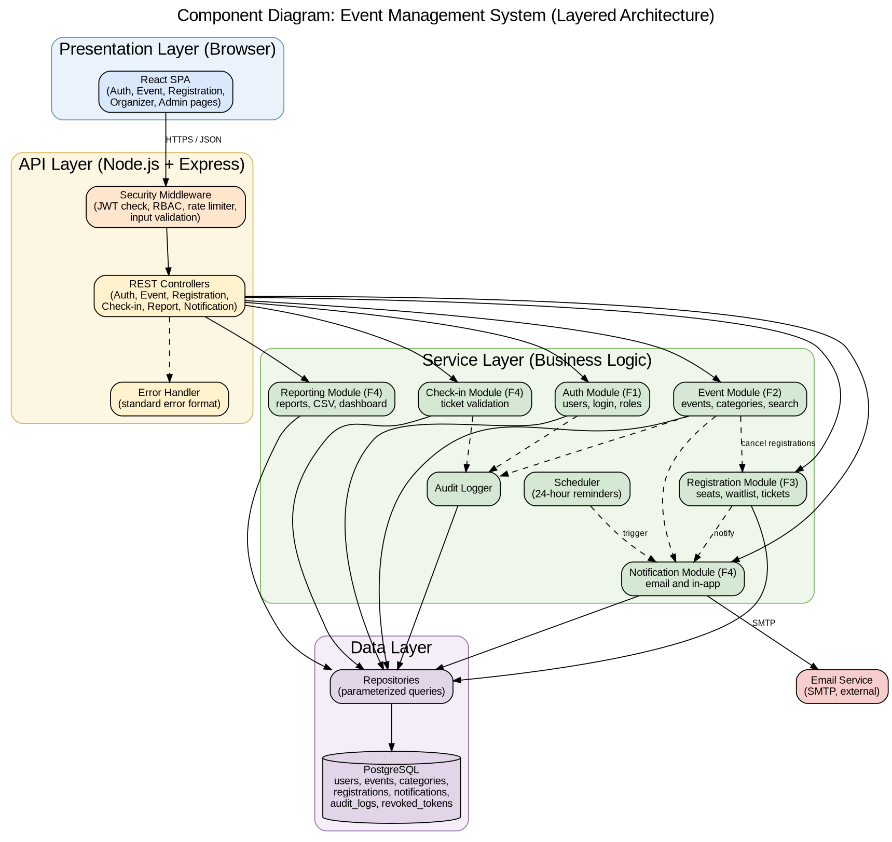

# Software Architecture and Design Specification (SAD)

**Project:** Event Management System (EMS)
**Version:** 1.0
**Authors:** Varun Rao (PES1UG24CS520), Thanishq Raam Patil (PES1UG24CS502), Vishruta (PES1UG24CS538), Nithin Kumar M (PES1UG25CS829)
**Date:** 13-10-2026
**Status:** Draft

## Revision History

| Version | Date | Author | Change Summary |
|---------|------|--------|----------------|
| 1.0 | 13-10-2026 | Team | Initial architecture and design specification |

## Approvals

| Role | Name | Signature / Date |
|------|------|------------------|
| Course Coordinator | | |

---

## 1. Introduction

### 1.1 Purpose
This document specifies the architecture and design of the Event Management System (EMS). It explains how the requirements in the SRS are realized by components, interfaces and interactions, and it is the basis for implementation and for the test plan.

### 1.2 Scope
The design covers the four functional features of EMS: authentication and role management (F1), event creation and management (F2), event registration and ticketing (F3), and check-in, notifications and reports (F4). Payment processing and native mobile applications are out of scope, as in the SRS.

### 1.3 Audience
Developers, QA engineers, security reviewers, project guides and evaluators, and the maintenance team.

### 1.4 Definitions
EMS, SRS, STP, RTM, SAD, REST, JWT, RBAC, STRIDE, TLS, SMTP, ADR, CI. The full list is in the appendix (section 5.1).

---

## 2. Document Overview

### 2.1 How to Use This Document
Section 3 describes the architecture: goals, components, the chosen pattern, the technology stack, risks, traceability and security. Section 4 describes the design: data model, UML sequence diagrams, API design, error handling and UX. Section 5 contains the appendices.

### 2.2 Related Documents
SRS v1.0 (requirements and security requirements), Software Test Plan v1.0 (test cases and security validation), and the Requirements Traceability Matrix.

---

## 3. Architecture

### 3.1 Goals and Constraints

**Goals**
- **Correctness under concurrency:** no event is ever overbooked (EVT-NF-004).
- **Security:** protect credentials, enforce roles and ownership, and record security events (EVT-SR-001 to EVT-SR-007).
- **Performance and availability:** 95% of API requests within 2 seconds, and 99% monthly availability (EVT-NF-001, EVT-NF-002).
- **Maintainability:** modular code that each team member can own, with at least 70% unit test coverage (EVT-NF-005).

**Constraints**
- Technology stack fixed to React.js, Node.js with Express and PostgreSQL.
- No payment processing, so every event is free to register for.
- Delivered by a team of four within the academic semester, using Agile with GitHub, GitHub Actions and SonarQube.
- Email delivery depends on an external SMTP service.

### 3.2 Stakeholders and Concerns

| Stakeholder | Concerns |
|-------------|----------|
| Attendee | Easy registration, reliable tickets and notifications, privacy of personal data |
| Organizer | Control of own events, accurate registration and attendance data |
| Admin | User and category management, platform visibility |
| Developers | Modularity, clear interfaces, ability to work in parallel |
| QA engineers | Testable components and traceability to requirements |
| Security reviewers | Compliance with the security requirements, defence against common attacks |
| Project guide and evaluators | Fit with the SRS, clear documentation, explainable design |

### 3.3 Component (UML) Diagram

*Figure 3.1: Component diagram of EMS. The editable source is `docs/diagrams/component-diagram.dot`.*

### 3.4 Component Descriptions

#### 3.4.1 Frontend and Cross-Cutting Components

| Component | Responsibility |
|-----------|----------------|
| React SPA | Single-page web interface with pages for visitors, attendees, organizers and admins. It calls the REST API over HTTPS, keeps the token in memory, and adapts the navigation to the user's role. |
| Security Middleware | Runs before every protected endpoint. It checks the JWT (EVT-SR-002), enforces role-based access (EVT-F-005), applies rate limiting (EVT-SR-007) and validates and sanitizes input (EVT-SR-003). |
| REST Controllers | Thin request handlers. They read the request, call one service method and return the response. They contain no business logic. |
| Error Handler | Converts every error into the standard error response format (see section 4.4). |
| Audit Logger | Writes audit entries for logins, role changes, event cancellations and check-ins (EVT-SR-006). |
| Repositories | The only code that talks to the database. All queries are parameterized (EVT-SR-003). |
| PostgreSQL | Persistent store for users, events, categories, registrations, notifications and audit logs. |
| Email Service (external) | SMTP provider used by the Notification Module to deliver emails. |

The descriptions of the feature modules follow in 3.4.2 (Auth, in `02-f1-authentication-design.md`), 3.4.3 (Event), 3.4.4 (Registration) and 3.4.5 (Check-in, Notification and Reporting).

### 3.5 Chosen Architecture Pattern and Rationale

**Pattern:** a layered (n-tier) architecture, deployed as a single backend application with a separate React frontend. The layers are Presentation, API, Service and Data. A layer may only call the layer directly below it.

**Rationale**
- Separation of concerns: UI, request handling, business rules and data access can be developed and tested separately.
- Parallel work: each team member owns one service module and its controller, repository and tests, which fits the one-feature-per-member rule.
- Simple deployment and debugging for a project of this size, with one Docker container for the backend.
- Transactions are easy: seat allocation and waitlist promotion run in one database transaction in the Registration Module, which prevents overbooking.

**Alternatives rejected**
- *Microservices:* rejected as too complex for four developers and one semester. They would add network calls, distributed transactions and deployment overhead without a matching benefit.
- *Serverless functions:* rejected because cold starts and scattered state make seat allocation and scheduled reminders harder to control.

### 3.6 Technology Stack and Data Stores

| Concern | Choice |
|---------|--------|
| Frontend | React.js with React Router |
| Backend | Node.js with Express |
| Database | PostgreSQL, with tables `users`, `events`, `categories`, `registrations`, `notifications`, `audit_logs` and `revoked_tokens` (see section 4.1) |
| Authentication | JWT, bcrypt for password hashing |
| Email | Nodemailer with an SMTP provider (a local mail catcher such as MailHog in testing) |
| Scheduling | node-cron for the 24-hour reminder job |
| QR codes | `qrcode` library |
| Testing | Jest and Supertest, with load tests in k6 or JMeter |
| CI/CD and quality | GitHub Actions, SonarQube, npm audit |
| Packaging | Docker and Docker Compose |
