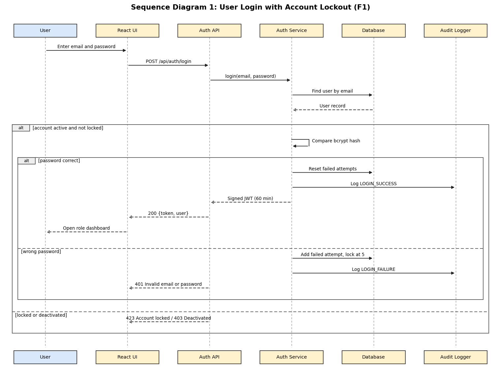

# Authentication and Role Management: Component, Sequence and API (Feature F1)

**Feature owner:** Varun Rao (PES1UG24CS520)

## 3.4.2 Auth Module (Component Description)

| Item | Description |
|------|-------------|
| Purpose | Registers users, authenticates them, enforces account lockout and lets admins manage users and roles |
| Requirements | EVT-F-001 to EVT-F-007, EVT-SR-001, EVT-SR-002 |
| Main classes | `AuthController`, `AuthService`, `UserService`, `UserRepository` |
| Depends on | Repositories (users table), Audit Logger, Security Middleware (JWT) |
| Key rules | Passwords are stored only as bcrypt hashes. Five consecutive failed logins lock the account for 15 minutes. Tokens are signed JWTs that expire after 60 minutes. A deactivated user cannot log in. An admin cannot deactivate their own account. Logins (success and failure) and role changes are written to the audit log. Logout stores the token ID in the `revoked_tokens` table until the token expires. |

## 4.2.1 Sequence Diagram: User Login with Account Lockout

*The editable PlantUML source is `docs/diagrams/sequence-1-login.puml`. This flow covers EVT-F-002 and EVT-F-003.*

## 4.3.1 API Design: Auth Module

All endpoints use JSON over HTTPS. Errors use the standard format in section 4.4.

### POST /api/auth/register

| Item | Details |
|------|---------|
| Access | Public |
| Request | `{ "name": "Asha", "email": "asha@ems.test", "password": "Test@1234", "role": "ATTENDEE" }` |
| Success | `201 { "userId": 12, "name": "Asha", "email": "asha@ems.test", "role": "ATTENDEE" }` |
| Errors | `400 VALIDATION_ERROR` (weak password, bad email or role), `409 EMAIL_EXISTS` |
| Requirement | EVT-F-001 |

### POST /api/auth/login

| Item | Details |
|------|---------|
| Access | Public |
| Request | `{ "email": "asha@ems.test", "password": "Test@1234" }` |
| Success | `200 { "token": "<jwt>", "expiresIn": 3600, "user": { "id": 12, "name": "Asha", "role": "ATTENDEE" } }` |
| Errors | `401 INVALID_CREDENTIALS` (same message for wrong password and unknown email), `403 ACCOUNT_DEACTIVATED`, `423 ACCOUNT_LOCKED`, `429 TOO_MANY_REQUESTS` |
| Requirement | EVT-F-002, EVT-F-003 |

### POST /api/auth/logout

| Item | Details |
|------|---------|
| Access | Any logged-in user |
| Request | Authorization header with the token |
| Success | `204` with no body. The token is added to a revoked-token list until it expires. |
| Errors | `401 UNAUTHORIZED` |
| Requirement | EVT-F-004 |

### User administration and profile

| Method and path | Access | Purpose | Main errors | Requirement |
|-----------------|--------|---------|-------------|-------------|
| `GET /api/users` | Admin | List users with role and status | 401, 403 | EVT-F-006 |
| `PATCH /api/users/:id/role` | Admin | Body `{ "role": "ORGANIZER" }`, change a user's role | 400, 403, 404 | EVT-F-006 |
| `PATCH /api/users/:id/status` | Admin | Body `{ "active": false }`, deactivate or reactivate | 403, 404, 409 (own account) | EVT-F-006 |
| `GET /api/users/me` | Logged-in user | View own profile | 401 | EVT-F-007 |
| `PUT /api/users/me` | Logged-in user | Update name and phone number | 400, 401 | EVT-F-007 |
| `PUT /api/users/me/password` | Logged-in user | Body `{ "currentPassword", "newPassword" }` | 400, 401, 403 (wrong current password) | EVT-F-007 |
