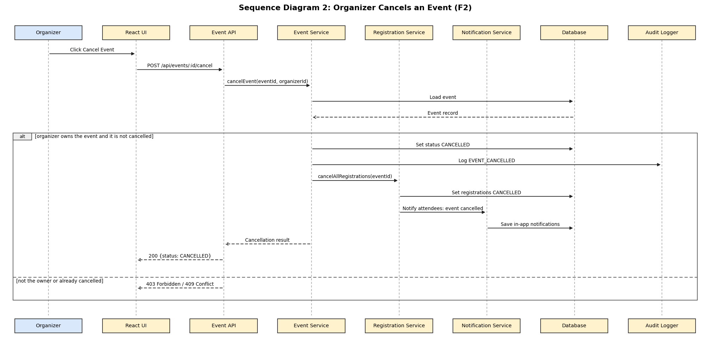

# Event Creation and Management: Component, Sequence and API (Feature F2)

**Feature owner:** Thanishq Raam Patil (PES1UG24CS502)

## 3.4.3 Event Module (Component Description)

| Item | Description |
|------|-------------|
| Purpose | Lets organizers create, edit, publish and cancel events, lets admins manage categories, and provides search and filtering of published events |
| Requirements | EVT-F-010 to EVT-F-016, EVT-NF-002, EVT-NF-006, EVT-SR-003 |
| Main classes | `EventController`, `EventService`, `CategoryService`, `EventRepository`, `CategoryRepository` |
| Depends on | Repositories (events and categories tables), Registration Module (cancel registrations), Notification Module, Audit Logger |
| Key rules | New events start as DRAFT and are visible to the public only after publishing. Only the owning organizer can edit, publish or cancel an event. Capacity cannot drop below the number of confirmed registrations. A category that is in use cannot be deleted. Cancelling an event cancels all its registrations and notifies the attendees. Every event cancellation is written to the audit log (EVT-SR-006). |

**Event statuses:** DRAFT, PUBLISHED, CANCELLED.

## 4.2.2 Sequence Diagram: Organizer Cancels an Event

*The editable PlantUML source is `docs/diagrams/sequence-2-cancel-event.puml`. This flow covers EVT-F-014, the notification trigger in EVT-F-032 and the audit entry required by EVT-SR-006.*

## 4.3.2 API Design: Event Module

### POST /api/events

| Item | Details |
|------|---------|
| Access | Organizer |
| Request | `{ "title": "Tech Meetup", "description": "...", "categoryId": 2, "venue": "Hall A", "startTime": "2026-11-05T10:00:00+05:30", "endTime": "2026-11-05T13:00:00+05:30", "capacity": 50 }` |
| Success | `201 { "eventId": 31, "status": "DRAFT", ... }` |
| Errors | `400 VALIDATION_ERROR` (empty title, start not in the future, end not after start, capacity not 1 to 10000), `401`, `403 FORBIDDEN` |
| Requirement | EVT-F-010, EVT-F-011 |

### PUT /api/events/:id

| Item | Details |
|------|---------|
| Access | Organizer who owns the event |
| Request | Any editable event fields, using the same validation rules as creation |
| Success | `200` with the updated event |
| Errors | `400 VALIDATION_ERROR`, `403 FORBIDDEN` (not the owner), `404 NOT_FOUND`, `409 CAPACITY_BELOW_CONFIRMED` |
| Requirement | EVT-F-012 |

### POST /api/events/:id/publish and POST /api/events/:id/cancel

| Item | Details |
|------|---------|
| Access | Organizer who owns the event |
| Request | No body |
| Success | `200 { "eventId": 31, "status": "PUBLISHED" }` or `{ "status": "CANCELLED" }` |
| Errors | `403 FORBIDDEN`, `404 NOT_FOUND`, `409 INVALID_STATE` (for example publishing a cancelled event) |
| Requirement | EVT-F-013, EVT-F-014 |

### GET /api/events

| Item | Details |
|------|---------|
| Access | Public (published events only) |
| Query | `q` (keyword), `categoryId`, `from`, `to` (dates), `page` (default 1). The page size is fixed at 10. |
| Success | `200 { "page": 1, "pageSize": 10, "total": 25, "events": [ ... ] }` |
| Errors | `400 VALIDATION_ERROR` (bad date or page) |
| Requirement | EVT-F-016 |

### Other event and category endpoints

| Method and path | Access | Purpose | Main errors | Requirement |
|-----------------|--------|---------|-------------|-------------|
| `GET /api/events/:id` | Public (published) or owner (draft) | Event details | 404 | EVT-F-016 |
| `GET /api/events/mine` | Organizer | The organizer's own events with registration counts | 401, 403 | EVT-F-010 |
| `GET /api/categories` | Public | List categories | none | EVT-F-015 |
| `POST /api/categories` | Admin | Add a category | 400, 409 | EVT-F-015 |
| `PUT /api/categories/:id` | Admin | Rename a category | 400, 404 | EVT-F-015 |
| `DELETE /api/categories/:id` | Admin | Delete a category | 404, 409 (in use) | EVT-F-015 |
