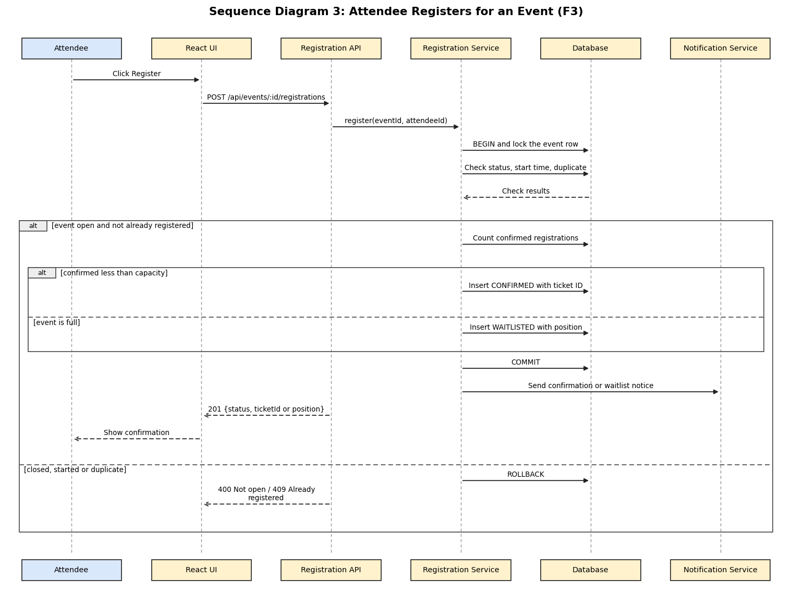

# Event Registration and Ticketing: Component, Sequence and API (Feature F3)

**Feature owner:** Vishruta (PES1UG24CS538)

## 3.4.4 Registration Module (Component Description)

| Item | Description |
|------|-------------|
| Purpose | Registers attendees for events, manages the waitlist, handles cancellations with automatic promotion, and provides tickets with QR codes |
| Requirements | EVT-F-020 to EVT-F-027, EVT-NF-003, EVT-NF-004, EVT-SR-004, EVT-SR-005 |
| Main classes | `RegistrationController`, `RegistrationService`, `TicketService`, `RegistrationRepository` |
| Depends on | Repositories (registrations and events tables), Notification Module |
| Key rules | A registration is CONFIRMED when a seat is free and WAITLISTED when the event is full. An attendee can have only one active registration per event. Registration and cancellation each run in one transaction with the event row locked, so confirmed registrations never exceed capacity. When a confirmed registration is cancelled, the first waitlisted attendee (first in, first out) is promoted to CONFIRMED in the same transaction and notified. Cancelling after the start time is refused. |

**Registration statuses:** CONFIRMED, WAITLISTED, CANCELLED, CHECKED_IN.

## 4.2.3 Sequence Diagram: Attendee Registers for an Event

*The editable PlantUML source is `docs/diagrams/sequence-3-register-for-event.puml`. This flow covers EVT-F-020, EVT-F-021 and EVT-F-022, and shows how overbooking is prevented (EVT-NF-004).*

## 4.3.3 API Design: Registration Module

### POST /api/events/:id/registrations

| Item | Details |
|------|---------|
| Access | Attendee |
| Request | No body. The attendee comes from the token and the event from the path. |
| Success | `201 { "registrationId": 88, "status": "CONFIRMED", "ticketId": "TKT-7F3A21" }` or `201 { "registrationId": 89, "status": "WAITLISTED", "waitlistPosition": 1 }` |
| Errors | `400 EVENT_NOT_OPEN`, `401`, `403 FORBIDDEN`, `404 NOT_FOUND`, `409 ALREADY_REGISTERED` |
| Requirement | EVT-F-020, EVT-F-021, EVT-F-022 |

### POST /api/registrations/:id/cancel

| Item | Details |
|------|---------|
| Access | Attendee who owns the registration |
| Request | No body |
| Success | `200 { "registrationId": 88, "status": "CANCELLED", "promotedRegistrationId": 89 }` (the promoted ID is null when nobody was waiting) |
| Errors | `400 EVENT_NOT_OPEN` (event already started), `403 FORBIDDEN`, `404 NOT_FOUND`, `409 INVALID_STATE` (already cancelled) |
| Requirement | EVT-F-023, EVT-F-024 |

### Other registration endpoints

| Method and path | Access | Purpose | Main errors | Requirement |
|-----------------|--------|---------|-------------|-------------|
| `GET /api/registrations/me` | Attendee | The attendee's registrations with event name, date and status | 401 | EVT-F-025 |
| `GET /api/registrations/:id/ticket` | Attendee who owns it | `{ "ticketId", "event", "qrCode" }` where `qrCode` is a data URL of a QR image encoding the ticket ID | 403, 404, 409 (not confirmed) | EVT-F-026 |
| `GET /api/events/:id/registrations` | Organizer who owns the event | Registrations with name, email, status and time | 403, 404 | EVT-F-027 |
