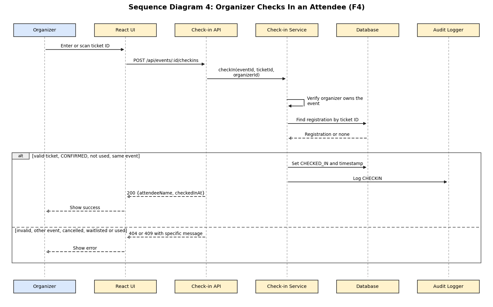

# Check-in, Notifications and Reports: Components, Sequence and API (Feature F4)

**Feature owner:** Nithin Kumar M (PES1UG25CS829)

## 3.4.5 Check-in, Notification and Reporting Modules (Component Description)

| Component | Responsibility |
|-----------|----------------|
| Check-in Module (`CheckinController`, `CheckinService`) | Validates a ticket ID for an event and marks the registration CHECKED_IN with a timestamp. Rejects unknown tickets, tickets of another event, and cancelled, waitlisted and already used tickets, each with its own message (EVT-F-030, EVT-F-031). The organizer must own the event. |
| Notification Module (`NotificationService`, `Mailer`, `Scheduler`) | Creates in-app notifications and sends emails for confirmation, waitlist promotion, cancellation and event cancellation (EVT-F-032). A scheduled job sends one reminder 24 hours before each event to Confirmed attendees only (EVT-F-033). Emails are sent asynchronously with up to 3 retries. Users can list and mark notifications as read (EVT-F-034). |
| Reporting Module (`ReportController`, `ReportService`) | Builds the event report with counts of Confirmed, Waitlisted, Cancelled and Checked-in registrations and the attendance rate, which is checked-in divided by confirmed as a percentage, and shows 0% when nobody is confirmed (EVT-F-035). Exports the attendee list as CSV (EVT-F-036) and provides the admin dashboard totals (EVT-F-037). |
| Audit Logger | Records logins, role changes, event cancellations and check-ins with timestamp, user ID and action (EVT-SR-006). |

Requirements covered: EVT-F-030 to EVT-F-037, EVT-NF-005, EVT-SR-006, EVT-SR-007.

## 4.2.4 Sequence Diagram: Organizer Checks In an Attendee

*The editable PlantUML source is `docs/diagrams/sequence-4-check-in.puml`. This flow covers EVT-F-030 and EVT-F-031.*

## 4.3.4 API Design: Check-in and Reporting

### POST /api/events/:id/checkins

| Item | Details |
|------|---------|
| Access | Organizer who owns the event |
| Request | `{ "ticketId": "TKT-7F3A21" }` |
| Success | `200 { "registrationId": 88, "attendeeName": "Asha", "checkedInAt": "2026-11-05T10:12:30+05:30" }` |
| Errors | `400 VALIDATION_ERROR` (missing ticket ID), `403 FORBIDDEN` (not the organizer of the event), `404 NOT_FOUND` (unknown ticket ID or a ticket of another event), `409 TICKET_ALREADY_USED`, `409 INVALID_STATE` (cancelled or waitlisted ticket) |
| Requirement | EVT-F-030, EVT-F-031 |

### GET /api/events/:id/report

| Item | Details |
|------|---------|
| Access | Organizer who owns the event |
| Success | `200 { "confirmed": 10, "waitlisted": 2, "cancelled": 1, "checkedIn": 8, "attendanceRate": 80.0 }` |
| Errors | `401`, `403 FORBIDDEN`, `404 NOT_FOUND` |
| Requirement | EVT-F-035 |

### Other F4 endpoints

| Method and path | Access | Purpose | Main errors | Requirement |
|-----------------|--------|---------|-------------|-------------|
| `GET /api/events/:id/attendees.csv` | Organizer who owns the event | CSV with name, email, status and check-in time | 403, 404 | EVT-F-036 |
| `GET /api/notifications` | Logged-in user | The user's in-app notifications | 401 | EVT-F-034 |
| `PATCH /api/notifications/:id/read` | Owner of the notification | Mark a notification as read | 403, 404 | EVT-F-034 |
| `GET /api/admin/dashboard` | Admin | Totals of users by role, events by status and registrations | 401, 403 | EVT-F-037 |
| `GET /health` | Public | Status of the API and the database | 503 when the database is unreachable | EVT-NF-002 |
